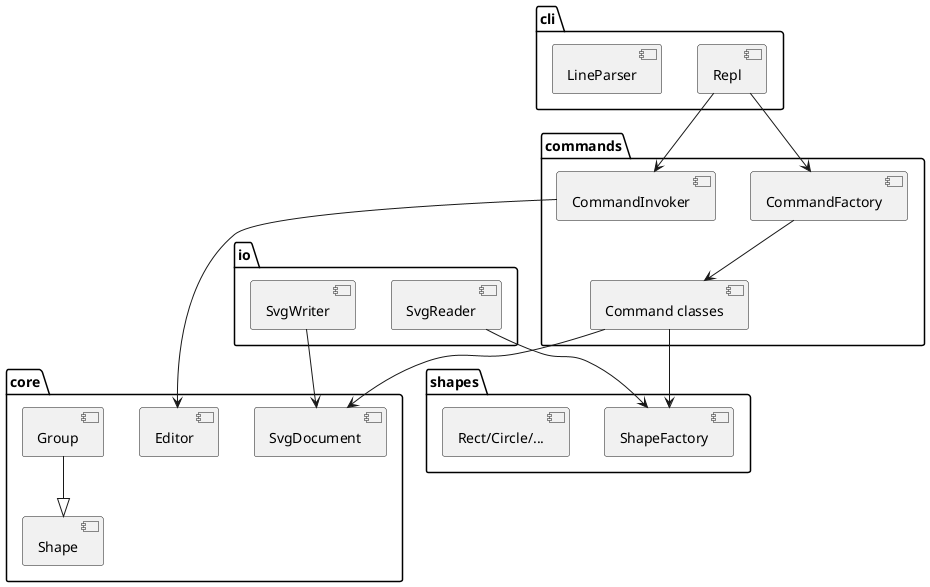

# SVG 编辑器（CLI）架构方案

Lab1 Phase 1。实现语言：TypeScript + 面向对象。入口：`npm run cli`。

## 1. 模块划分

| 目录 | 职责 |
|---|---|
| `src/cli` | REPL：提示符 `svg>`、注释、引号分词、把一行交给命令层 |
| `src/commands` | Command 模式：每条命令一个类；Invoker 维护 undo/redo；CommandFactory 是命令名分派点 |
| `src/core` | 文档、id 注册表、Shape 抽象、Group 容器（Composite） |
| `src/shapes` | 六种内置图形 + ShapeFactory（类型名分派点） |
| `src/io` | SVG 读入 / 写出，与对象模型隔离 |

**允许的按名分派（待后续插件化重构）：**

1. `CommandFactory.create`：命令名 → 命令类
2. `ShapeFactory.create`：类型名 → 图形类

本阶段 `create box` 走工厂默认分支，报 `unknown shape type`。

## 2. 设计模式

### Command（必做）

- `Command`：`execute` / `undo`，以及 `kind`（edit / io / query）
- 编辑命令入 undo 栈；新编辑清空 redo 栈
- 显示命令不入栈
- `init` / `read` / `save` / 修改 `canvas` 之后禁止 undo/redo，直到下一次编辑命令解禁

### Composite

`Group` 与叶子共用 `move` / `scale` / `set` / `delete` / `toSvg` / `toTreeLine`。对容器的平移、缩放递归到子孙。

### Factory

`ShapeFactory` 根据类型名构造 Rect/Circle/Ellipse/Line/Text/Group。

## 3. 依赖方向

允许：

- `cli` → `commands` → `core` / `shapes`
- `io` → `core` / `shapes`
- `shapes` → `core`
- `core` 不依赖 `cli`、`commands`、`io`

禁止：

- 核心模型依赖 REPL 或文件系统
- 图形类依赖具体 Command 类

## 4. 变化点假设

| 变化 | 本阶段处理 |
|---|---|
| 新图形 / `box` 插件 | 只留工厂分派点；不实现 ShapeProvider |
| CLI → GUI / agent | 命令层与 REPL 分离，GUI 可复用 Command + Document |
| SVG 读写实现替换 | 隔离在 `io/` |
| 用路径寻址代替 id | 不留：本阶段约定用 id |

## 5. 过程记录（初稿）

- 先定四层目录和 Command/Composite，再写 REPL，避免把 XML 字符串当模型。
- `group` 的 undo 不能 `delete` 整棵子树，否则子节点会从 id 表消失；改为只注销容器自身。
- IO 命令与编辑命令用 `kind` 区分，避免 `save` 后误入 undo 栈。

## 6. 一致性自查（实现后填）

1. 模块划分：目录已按方案创建。后续若改名，记入本节。
2. 依赖方向：抽查 `core/` 的 import，不应出现 `cli` / `io`。

## 7. 质量保证手段（计划）

- 回放 `phase_cli_1.md` 第 6 节典型会话与流程图会话
- 对照 4.2 错误文案
- `save` 后用浏览器打开 SVG
- `npm run build`（`tsc --noEmit`）保证类型通过
