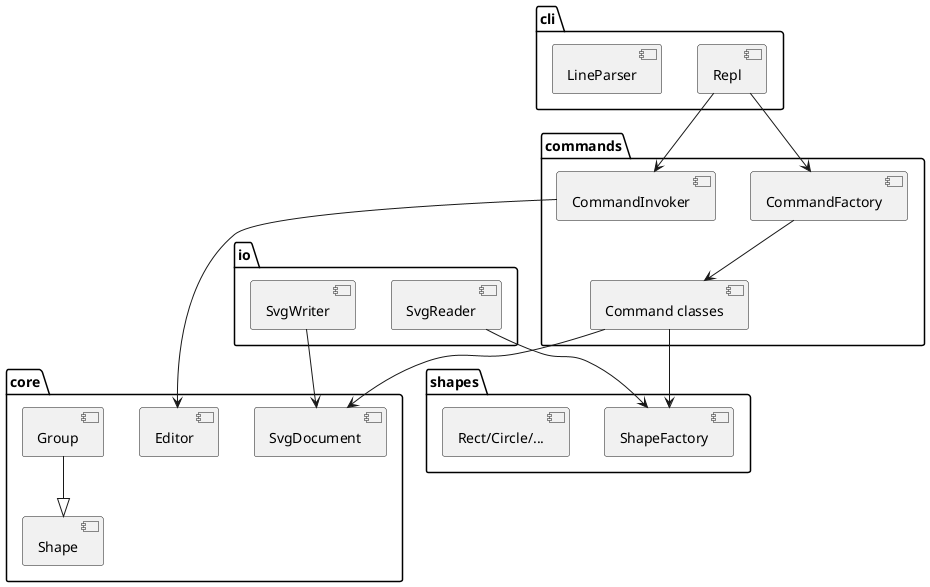

# SVG 编辑器（CLI）架构方案

Lab1 Phase 1。实现语言：TypeScript + 面向对象。入口：`npm run cli`。

## 1. 模块划分

| 目录 | 职责 |
|---|---|
| `src/cli` | REPL：提示符 `svg>`、注释、引号分词、把一行交给命令层 |
| `src/commands` | Command 模式：每条命令一个类；Invoker 维护 undo/redo；CommandFactory 是命令名分派点 |
| `src/core` | 文档、id 注册表、Shape 抽象、Group 容器（Composite） |
| `src/shapes` | 六种内置图形 + ShapeFactory（类型名分派点） |
| `src/io` | SVG 读入 / 写出，与对象模型隔离 |



**允许的按名分派（待后续插件化重构）：**

1. `CommandFactory.create`：命令名 → 命令类
2. `ShapeFactory.create`：类型名 → 图形类

本阶段 `create box` 走工厂默认分支，报 `unknown shape type`。

## 2. 设计模式的选择

### Command（必做）

- `Command`：`execute` / `undo`，以及 `kind`（edit / io / query）
- 编辑命令入 undo 栈；新编辑清空 redo 栈
- 显示命令不入栈
- `init` / `read` / `save` / 修改 `canvas` 之后禁止 undo/redo，直到下一次编辑命令解禁

### Composite

`Group` 与叶子共用 `move` / `scale` / `set` / `delete` / `toSvg` / `toTreeLine`。对容器的平移、缩放递归到子孙。

### Factory

`ShapeFactory` 根据类型名构造 Rect/Circle/Ellipse/Line/Text/Group。

## 3. 依赖方向

允许：

- `cli` → `commands` → `core` / `shapes`
- `io` → `core` / `shapes`
- `shapes` → `core`
- `core` 不依赖 `cli`、`commands`、`io`

禁止：

- 核心模型依赖 REPL 或文件系统
- 图形类依赖具体 Command 类

## 4. 变化点假设

| 变化 | 本阶段处理 |
|---|---|
| 新图形 / `box` 插件 | 只留工厂分派点；不实现 ShapeProvider |
| CLI → GUI / agent | 命令层与 REPL 分离，GUI 可复用 Command + Document |
| SVG 读写实现替换 | 隔离在 `io/` |
| 用路径寻址代替 id | 不留：本阶段约定用 id |

## 5. 过程记录

### 5.1 先定四层目录和 Command/Composite，再写 REPL

最初的方案是「一个 `SvgEditor` 类 + 一堆命令函数」。写之前先把依赖方向画出来，才把 REPL 和命令层拆开：REPL 只负责读行和分词，命令层负责语义，模型层完全不认识 I/O。这样后面加 `read` / `save` 时，模型层一行都不用改。

### 5.2 `group` 的 undo 不能 `delete` 整棵子树

第一版 `GroupCommand.undo()` 复用了 `SvgDocument.delete()`，它会递归注销整棵子树的 id。结果是 `group` 之后一次 `undo`，`show c1` 就变成 `error: no such shape: c1` —— 子图形明明还在树上，却从 id 表里消失了。

改为只注销容器自身（`IdRegistry.unregisterSelf`），子图形的 id 保留。`IdRegistry` 因此拆成两个方法：`unregisterSelf` 与递归的 `unregister`，语义差别在名字里显式表达。

### 5.3 IO 命令与编辑命令用 `kind` 区分

一开始想让每条命令自己决定要不要入 undo 栈，结果 `save` 之后 `undo` 会把上一步编辑撤掉 —— 语义上不对：保存文件不应该改变编辑历史。

改为在 `Command` 上加 `kind`（edit / io / query），由 `CommandInvoker` 统一处理：

- `edit` → 入 undo 栈，并清空 redo 栈
- `io` → 不入栈，但把编辑器标记为 io 锁定
- `query` → 完全不碰栈

io 锁定在 `Editor` 上（`markIo` / `markEdit` / `assertUndoAllowed`），由 `init` / `read` / `save` / 改 `canvas` 触发、下一条编辑命令解除。

### 5.4 读入 SVG 时 `<g transform>` 被静默丢弃

用作业文档 §0.1 的嵌套 `<g>` 例子试 `read`，发现 `rect#a` 在源文件里挂在 `translate(60,40)` 的组下、视觉位置应是 (60,40)，读进来却变成 `x=0 y=0`；`scale(0.8)` 同样丢失。再 `save` 一次，变换信息彻底消失，图形位置全错。

根因：对象模型里没有 `transform` 属性，`Group` 是把 move/scale **摊平到子孙几何属性**上的；而 `SvgReader` 解析 `<g>` 时只取 id 和子节点，属性直接丢弃。

修法：新增 `src/io/Transform.ts`，解析 `translate(x,y)` 与 `scale(s)`，读入时按 SVG 的嵌套顺序（内层先作用于原始坐标，外层后作用）把这些变换**摊平到子树**。这样读进来的几何值与浏览器渲染一致，再 `save` 出去也就等价了。

同时对 `rotate` / `matrix` / `skew` 这类本阶段无法表达的变换打 warning，而不是静默丢弃。

验收：`fixtures/transform.svg` 读入后 `rect#a` 为 `x=60 y=40`，`nodeB` 内的矩形为 `x=260 y=40 w=96 h=48`。

### 5.5 `tree` 的列对齐不该由各图形类自己负责

最早每个图形类的 `toTreeLine()` 里都硬编码了一串空格（`Rect` 8 个、`Circle` 2 个）来对齐，结果 id 一长就错位，同一层图形看起来参差不齐。

根因是**显示责任放错了层**：对齐需要知道同层所有兄弟的标签宽度，这是容器（文档层）的信息，图形类看不到。

重构：`Shape` 拆出 `treeLabel()`（标签）、`treeGeometry()`（几何）、`treeStyleAttributes()`（样式）、`treeDetail()`（后两者拼接），`toTreeLine()` 由基类统一拼装；`SvgDocument.appendTree()` 计算同层最大标签宽度后统一补齐。图形类只提供自己的内容，不再关心空格。

顺带清掉了重构过程中发现的两处死代码：五个图形类里的 `showBody()` 无人调用，`SvgDocument.show()` 也无人调用（`ShowCommand` 自己重写了一遍显示逻辑）。

### 5.6 规范未覆盖的两个边界

- 空 undo 栈时 `undo` 报 `error: nothing to undo`，作业文档 §4.2 的错误表没有收录这一条，实现时补上了；
- `save` 未指定路径且当前文档不是 `read` 进来的，报 `error: cannot write file: (no path)`。

两处都在提交前统一了文案风格：`error:` 前缀、单行、不带句号。

## 6. 一致性自查

### 6.1 模块划分

实际目录与方案一致：`src/cli`、`src/commands`、`src/core`、`src/shapes`、`src/io` 五个目录，`src/index.ts` 是程序入口，`src/runTranscript.ts` 是回放器。方案 §1 的表格与 plantuml 图未作修订。

一处偏差：方案提到「`src/core` 不依赖 `cli`、`commands`、`io`」，实现时 `core` 内部多了一个 `IdRegistry`，是 §1 表格里「id 注册表」这一行的具体落地，属于方案内的细化，不算偏离。

### 6.2 依赖方向

抽查方式是扫全部 import 语句，确认没有跨层的反向依赖。

`src/core/` 的全部 import：

```
Editor.ts        → ./EditorError.js  ./SvgDocument.js
Group.ts         → ./EditorError.js  ./Shape.js
IdRegistry.ts    → ./EditorError.js  ./Shape.js
Shape.ts         → ./Group.js（仅 type）
SvgDocument.ts   → ./EditorError.js  ./Group.js  ./IdRegistry.js  ./Shape.js（type）
```

全部指向 `core` 内部，**没有任何一条指向 `cli` / `commands` / `io`**，符合方案 §3。

`src/shapes/` 的全部 import：

```
Circle/Ellipse/Line/Rect/Text.ts  → ../core/EditorError.js  ../core/Shape.js
ShapeFactory.ts                   → ../core/*  ./Circle.js ... ./Text.js
```

图形类只依赖 `core`，彼此不互相引用（唯一的横向引用在 `ShapeFactory`），**没有任何一条指向 `commands`**，符合「图形类不依赖具体 Command 类」。

`src/io/` 的 import：

```
SvgReader.ts  → ../core/*  ../shapes/ShapeFactory.js  ./Transform.js
SvgWriter.ts  → ../core/SvgDocument.js
```

`io` → `core` / `shapes`，不反向依赖，符合方案。

唯一允许的跨层依赖出现在 `commands` 与 `cli`：`ReadCommand` / `SaveCommand` 以 `import type` 引用 `io` 的 `SvgReader` / `SvgWriter`，`CommandFactory` 同理。这是「命令需要 IO 实现」的注入点，方向仍然是上层依赖下层，不构成反向依赖。

## 7. 质量保证手段

### 7.1 类型检查

```powershell
npm run build      # tsc --noEmit
```

无输出即通过。保证所有提交在类型层面自洽。

### 7.2 脚本回放

```powershell
npm run replay fixtures/session1.txt
npm run replay fixtures/flowchart.txt
```

`fixtures/session1.txt` 是作业文档 §6 的典型会话，`fixtures/flowchart.txt` 是 §6.1 的两节点流程图。回放器把每行命令喂给 REPL 并打印输出，可用来回归验证 undo/redo、错误文案、树形输出。

### 7.3 手工会话

用 `npm run cli` 手工敲过以下场景，逐条核对输出：

- `init` / `read` / `save` / `canvas` 四条文档类命令，以及 io 锁定后 `undo` 被拒、下一条编辑命令后解禁
- `group` / `ungroup` / `addto` 的父子关系往返，确认 undo 后子图形仍在原父容器的原位置
- 容器与叶子的 `move` / `scale` 递归（嵌套两层同样生效）
- 全部 §4.2 错误文案：`id already exists` / `no such shape` / `not a container` / `cannot ungroup top-level container` / `unknown attribute` / `unknown shape type` / `scale factor must be positive`
- 失败命令不改变状态（报错后 `tree` 内容不变）

### 7.4 渲染验证

`save` 出来的 `.svg` 用浏览器直接打开，确认图形位置、填充色、连线走向与 `tree` 输出一致。这是 IO 层正确性的唯一硬证据。

### 7.5 依赖方向抽样

```powershell
Get-ChildItem src/core/*.ts | ForEach-Object { Select-String -Path $_.FullName -Pattern '^import' }
```

输出见 §6.2。
