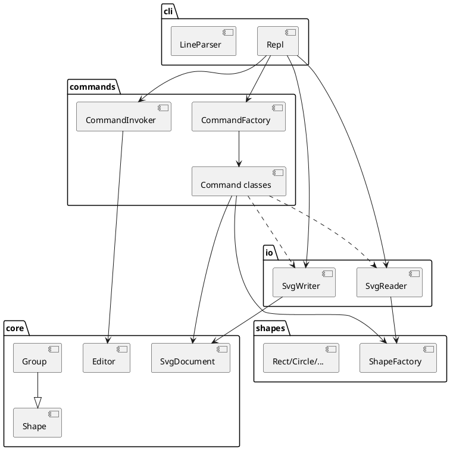

# SVG 编辑器（CLI）架构方案

Lab1 Phase 1。实现语言：TypeScript + 面向对象。入口：`npm run cli`。

## 1. 模块划分

| 目录 | 职责 |
|---|---|
| `src/cli` | REPL：提示符 `svg>`、注释、引号分词、把一行交给命令层 |
| `src/commands` | Command 模式：每条命令一个类；Invoker 维护 undo/redo；CommandFactory 是命令名分派点 |
| `src/core` | 文档、id 注册表、Shape 抽象、Group 容器（Composite） |
| `src/shapes` | 六种内置图形 + ShapeFactory（类型名分派点） |
| `src/io` | SVG 读入 / 写出，与对象模型隔离 |



**允许的按名分派（待后续插件化重构）：**

1. `CommandFactory.create`：命令名 → 命令类
2. `ShapeFactory.create`：类型名 → 图形类

本阶段 `create box` 走工厂默认分支，报 `unknown shape type`。

## 2. 设计模式的选择

### Command（必做）

- `Command`：`execute` / `undo`，以及 `kind`（edit / io / query）
- 编辑命令入 undo 栈；新编辑清空 redo 栈
- 显示命令不入栈
- `init` / `read` / `save` / 修改 `canvas` 之后禁止 undo/redo，直到下一次编辑命令解禁

### Composite

`Group` 与叶子共用 `move` / `scale` / `set` / `delete` / `toSvg` / `toTreeLine`。对容器的平移、缩放递归到子孙。

### Factory

`ShapeFactory` 根据类型名构造 Rect/Circle/Ellipse/Line/Text/Group。

## 3. 依赖方向

允许：

- `cli` → `commands` → `core` / `shapes`
- `cli` → `io`：入口处组装 reader / writer 并注入命令层（组合根，只有 `Repl` 一处）
- `commands` → `io`：仅 `read` / `save` 两条命令注入 reader / writer 时使用（见 §5.8，是实现中补充的规则）
- `io` → `core` / `shapes`
- `shapes` → `core`
- `core` 不依赖 `cli`、`commands`、`io`

禁止：

- 核心模型依赖 REPL 或文件系统
- 图形类依赖具体 Command 类
- `io` 反向引用 `commands`（否则与 `commands` → `io` 形成环）

理由：依赖只能自上而下。模型层不认识 CLI，才能脱离 REPL 单独实例化和验证；命令层只认抽象（`Shape` / `SvgDocument`），换掉 SVG 读写或换成 GUI 前端时不用改；`io` 是可替换的叶子模块，唯一入口是注入，不在命令内部 `new`。

## 4. 变化点假设

| 变化 | 本阶段处理 |
|---|---|
| 新图形 / `box` 插件 | 只留工厂分派点；不实现 ShapeProvider |
| CLI → GUI / agent | 命令层与 REPL 分离，GUI 可复用 Command + Document |
| SVG 读写实现替换 | 隔离在 `io/` |
| 用路径寻址代替 id | 不留：本阶段约定用 id |

## 5. 过程记录（与 AI 协作）

全程用 AI 编程助手（Cursor 内的 Agent）辅助：我负责定架构约束、跑验证、判断每条建议是否成立；AI 负责按约束出方案和写实现。下面记录的是**我认为最有代表性的几次"AI 给出的东西有问题，我如何确认并纠正"**。

### 5.1 第一版方案是个上帝类，我推翻重来

我最初让 AI 直接按作业要求出代码结构，给出的方案是「一个 `SvgEditor` 类 + 一堆 `addRect` / `moveShape` 之类的自由函数」，`main` 里一个 `switch(cmd)` 分发。这在作业里正好踩中两条禁止项：贫血模型 + 过程式分派。

我把作业 2.1 节"实现范式"那几条抄给它，要求重新设计，并补一条硬约束：**REPL、命令、模型三层必须分开，且核心模型不许 import I/O**。第二版才是现在的 `core` / `shapes` / `commands` / `io` / `cli` 五层。

这件事的收获是：AI 会给"能跑的最短路径"，架构约束必须由我先写死，否则它不会自己往设计模式上靠。

### 5.2 `group` 的 undo 会把子图形的 id 弄丢

AI 写的第一版 `GroupCommand.undo()` 直接调了 `SvgDocument.delete()`，而 `delete()` 会递归注销整棵子树的 id。我不放心，用 `group g1 c1 r1` → `undo` → `show c1` 的会话验了一遍，果然报 `error: no such shape: c1`：子图形还在树上，但 id 表里已经没有它。

改成只注销容器自身（`IdRegistry.unregisterSelf`），子图形的 id 保留。为此把 `IdRegistry` 拆成 `unregisterSelf` 与递归的 `unregister` 两个方法，语义差别写进名字里。

**AI 的代码"看起来对称"**——`delete` 对称地用 `restore` 恢复——但它没意识到 undo 的语义是"回到操作前"，而不是"撤销删除"。这类错误只能靠实际跑一次才发现。

### 5.3 IO 命令被混进 undo 栈

同一批代码里，AI 让每条命令自己决定要不要入 undo 栈，结果 `save` 之后 `undo` 会把上一步编辑撤掉——语义上不对：保存文件不该改变编辑历史。

我要求把"是否入栈"从各命令手里收回到统一调度处。最终在 `Command` 上加 `kind`（edit / io / query），由 `CommandInvoker` 统一处理：`edit` 入栈并清空 redo，`io` 不入栈但把 `Editor` 标记为锁定，`query` 完全不碰栈。锁定状态由 `init` / `read` / `save` / 改 `canvas` 触发、下一条编辑命令解除，对应作业 §4.3 的"文档类命令执行后禁止 undo/redo"。

### 5.4 `SvgReader` 静默丢弃 `<g transform>`

这是我认为最值得记的一条。AI 写的 `SvgReader` 能读回作业 §6 的 `other.svg`，回放全绿，看起来已经完成。但我拿作业 §0.1 那个带 `translate(60,40)` 和 `scale(0.8)` 的嵌套 `<g>` 例子去试，`rect#a` 读进来是 `x=0 y=0`——源文件里的变换被整段忽略了，而且**没有任何警告**。

根因：对象模型里没有 `transform` 字段（`Group` 是把 move/scale 摊平到子孙几何上的），而 reader 解析 `<g>` 时只取 id 和子节点，其余属性直接丢弃。

修法：新增 `src/io/Transform.ts`，解析 `translate(x,y)` 与 `scale(s)`，读入后按 SVG 的嵌套顺序（内层先作用于原始坐标，外层后作用）把变换摊平到子树。对 `rotate` / `matrix` / `skew` 这类本阶段表达不了的变换**打 warning 而不是静默丢弃**。

验收：`fixtures/transform.svg` 读入后 `rect#a` 为 `x=60 y=40`，`nodeB` 内矩形为 `x=260 y=40 w=96 h=48`，与浏览器渲染一致。

教训：**AI 生成的正例测试通不过只能说明"文档里举的例子能跑"，不能说明实现正确**。判别力来自我另外构造的边界用例。

### 5.5 `tree` 的列对齐放错了层

AI 在每个图形类的 `toTreeLine()` 里硬编码了一串空格来对齐（`Rect` 8 个、`Circle` 2 个）。id 一长就错位，同一层显示参差不齐，而作业 §5.1 明确要求属性内联且成列。

根因是责任错位：对齐需要知道**同层所有兄弟**的标签宽度，这是文档层的信息，图形类各自看不到。

重构：`Shape` 拆出 `treeLabel()` / `treeGeometry()` / `treeStyleAttributes()` / `treeDetail()`，`toTreeLine()` 由基类拼装；`SvgDocument.appendTree()` 先算同层最大标签宽度再统一补齐。顺带发现并删掉两处死代码：五个图形类里的 `showBody()` 无人调用，`SvgDocument.show()` 也无人调用（`ShowCommand` 自己重写了一份显示逻辑）。终检时又发现 `show` 把样式挤在几何那一行，不符合作业 §5.2「几何一行、每个样式属性各占一行」的格式；于是把 `ShowCommand` 改成直接复用 `SvgDocument.show()`，重复实现和格式问题一并解决。

### 5.6 AI 给的提交计划过度设计，我砍掉一半

我让 AI 规划提交拆分，它给了 20 条，包括 `show` 格式修复、`--check` 回放校验、parser 加固等。我判断这属于"为了显得专业而拆"，反而失真，压到 14 条：模块按依赖方向一条一类，只在**真发现问题**的地方单独留 `fix` / `refactor` 提交。

同样被纠正的还有：AI 一开始给的是一次性 `git add -A` 的脚本，那会把 `node_modules` 和所有模块打成一个巨型提交，直接违反作业"禁止 one-shot 大提交"。

另有一次执行失误值得记：我在 AI 给的收尾脚本里提前跑了 `git tag final`，而当时 `Transform.ts` 和文档还没改，那两条 `commit` 因无内容而空转，`final` 就落到了错误的提交上。发现后重新提交，再用 `git tag -f final` + `git push origin final --force` 把 tag 移到最终提交。

### 5.7 规范未覆盖的两个边界

- 空 undo 栈时 `undo` 报 `error: nothing to undo`，作业 §4.2 的错误表没有收录，实现时补上；
- `save` 未指定路径且当前文档不是 `read` 进来的，报 `error: cannot write file: (no path)`。

两处都统一成 `error:` 前缀、单行、不带句号的风格。

### 5.8 实现 `read` / `save` 时，依赖规则补了一条

方案第一版只写了 `cli → commands → core / shapes` 和 `io → core / shapes`，没有给 `commands → io` 留位置。写 `ReadCommand` / `SaveCommand` 时绕不过去：命令要调用 reader / writer，把它俩改成由 `CommandFactory` 注入。

两条路：把 `read` / `save` 提到 `cli` 层，或者承认 `commands → io`。选后者，因为把"读文件"这种语义硬塞进 REPL 会让 `cli` 变成第二套调度层。规则因此补了一条，并同时加了一条禁止项：**`io` 不许反向 import `commands`**，否则与这条一起成环。

这也是为什么 `ReadCommand` / `SaveCommand` 对 `io` 用的是 `import type`——只依赖类型，不依赖具体实现，将来换掉 SVG 实现时这两个文件不用动。

## 6. 一致性自查

### 6.1 模块划分

实际目录与方案一致：`src/cli`、`src/commands`、`src/core`、`src/shapes`、`src/io` 五个目录，`src/index.ts` 是程序入口，`src/runTranscript.ts` 是回放器。方案 §1 的表格与 plantuml 图未作修订。

未见偏离。`core` 内部按 §1 表格里「id 注册表」这一行拆出了 `IdRegistry`，属于方案内的细化，不是新增职责。

### 6.2 依赖方向

抽查方式是扫全部 import 语句，确认没有跨层的反向依赖。

`src/core/` 的全部 import：

```
Editor.ts        → ./EditorError.js  ./SvgDocument.js
Group.ts         → ./EditorError.js  ./Shape.js
IdRegistry.ts    → ./EditorError.js  ./Shape.js
Shape.ts         → ./Group.js（仅 type）
SvgDocument.ts   → ./EditorError.js  ./Group.js  ./IdRegistry.js  ./Shape.js（type）
```

全部指向 `core` 内部，**没有任何一条指向 `cli` / `commands` / `io`**，符合方案 §3。

`src/shapes/` 的全部 import：

```
Circle/Ellipse/Line/Rect/Text.ts  → ../core/EditorError.js  ../core/Shape.js
ShapeFactory.ts                   → ../core/*  ./Circle.js ... ./Text.js
```

图形类只依赖 `core`，彼此不互相引用（唯一的横向引用在 `ShapeFactory`），**没有任何一条指向 `commands`**，符合「图形类不依赖具体 Command 类」。

`src/io/` 的 import：

```
SvgReader.ts  → ../core/*  ../shapes/ShapeFactory.js  ./Transform.js
SvgWriter.ts  → ../core/SvgDocument.js
```

`io` → `core` / `shapes`，不反向依赖，符合方案。

`commands` 与 `io` 之间只有一处依赖：`ReadCommand` / `SaveCommand` 以 `import type` 引用 `SvgReader` / `SvgWriter`，`CommandFactory` 同理。方向是上层依赖下层的叶子模块，且 `io` 不反向引用 `commands`，不构成环——这条规则是 §5.8 记录的在实现中补充的一条，方案 §3 已同步更新。

`cli` 与 `io` 之间的依赖同样只有一处：`Repl` 在构造时实例化 `SvgReader` / `SvgWriter` 并注入 `CommandFactory`，即组合根。除 `Repl.ts` 外，`src/cli/` 与 `src/index.ts` 不再引用 `io`。

### 6.3 修订记录

实现过程中对方案做过三处修订，都已同步到 §1–§3 的正文，不是"实现偷偷跑偏"：

| 修订 | 落实到 | 原因 |
|---|---|---|
| 依赖方向新增 `commands → io`、`cli → io` | §3 允许清单 + 禁止 `io` 反引 `commands` | `read` / `save` 需要注入 reader / writer，见 §5.8 |
| 模块细化：`core` 内拆出 `IdRegistry` | §1 表格「id 注册表」一行 | undo 需要区分"注销自身"与"递归注销"两种语义，见 §5.2 |
| `Command` 增加 `kind`（edit / io / query） | §2 设计模式一节 | 文档类命令不得进 undo 栈，见 §5.3 |

除此之外，§1 的模块表、§2 的模式选择、§4 的变化点假设与实现一致，未作修订。

## 7. 质量保证手段

### 7.1 功能完整性对照

按作业 §4 的命令总表逐条核对，19 条命令全部实现，无占位：

| 命令 | 落地位置 | 状态 |
|---|---|---|
| `init` / `read` / `save` / `canvas` | `InitCommand` / `ReadCommand` / `SaveCommand` / `CanvasCommand` | ✅ |
| `create`（含 `in` 子句、六种类型） | `CreateCommand` + `ShapeFactory` | ✅ |
| `delete` / `move` / `scale` / `set` | `DeleteCommand` / `MoveCommand` / `ScaleCommand` / `SetCommand` | ✅ |
| `group` / `ungroup` / `addto` | `GroupCommand` / `UngroupCommand` / `AddToCommand` | ✅ |
| `front` / `back` | `ZOrderCommand` | ✅ |
| `tree` / `show` / `help` | `TreeCommand` / `ShowCommand` / `HelpCommand` | ✅ |
| `undo` / `redo` | `UndoCommand` / `RedoCommand` → `CommandInvoker` | ✅ |

错误文案逐条对照过 §4.2，见 §7.4。

### 7.2 类型检查

```powershell
npm run build      # tsc --noEmit
```

无输出即通过。保证所有提交在类型层面自洽。

### 7.3 脚本回放

```powershell
npm run replay fixtures/session1.txt
npm run replay fixtures/flowchart.txt
```

`fixtures/session1.txt` 是作业文档 §6 的典型会话，`fixtures/flowchart.txt` 是 §6.1 的两节点流程图。回放器把每行命令喂给 REPL 并打印输出，可用来回归验证 undo/redo、错误文案、树形输出。

### 7.4 手工会话

用 `npm run cli` 手工敲过以下场景，逐条核对输出：

- `init` / `read` / `save` / `canvas` 四条文档类命令，以及 io 锁定后 `undo` 被拒、下一条编辑命令后解禁
- `group` / `ungroup` / `addto` 的父子关系往返，确认 undo 后子图形仍在原父容器的原位置
- 容器与叶子的 `move` / `scale` 递归（嵌套两层同样生效）
- 全部 §4.2 错误文案：`id already exists: c1` / `no such shape: r9` / `no such container: node9` / `not a container: r1` / `cannot group a container into its own descendant` / `cannot ungroup top-level container: g1` / `unknown attribute: nope` / `unknown shape type: box` / `scale factor must be positive` / `cannot read file: nope.svg`
- 失败命令不改变状态（报错后 `tree` 内容不变）

### 7.5 渲染验证

`save` 出来的 `.svg` 用浏览器直接打开，确认图形位置、填充色、连线走向与 `tree` 输出一致。这是 IO 层正确性的唯一硬证据。`fixtures/transform.svg` 读入后摊平出的坐标（`rect#a` 为 `x=60 y=40`）与浏览器渲染同一文件的结果一致，可作为该方法的实例。

已知限制（均不影响本阶段验收项）：

- `<g transform>` 只支持 `translate` 与 `scale`，`rotate` / `matrix` / `skew` 会打 warning 并忽略；
- `canvas` 改尺寸后不回显新尺寸（`init` 有回显）；
- 未 `read` 过就 `save` 时错误为 `cannot write file: (no path)`，未按 §4.2 风格细化；
- `box` 插件、拖拽编辑、多行文本属后续阶段。

### 7.6 依赖方向抽样

```powershell
Get-ChildItem src/core/*.ts | ForEach-Object { Select-String -Path $_.FullName -Pattern '^import' }
```

输出见 §6.2。
